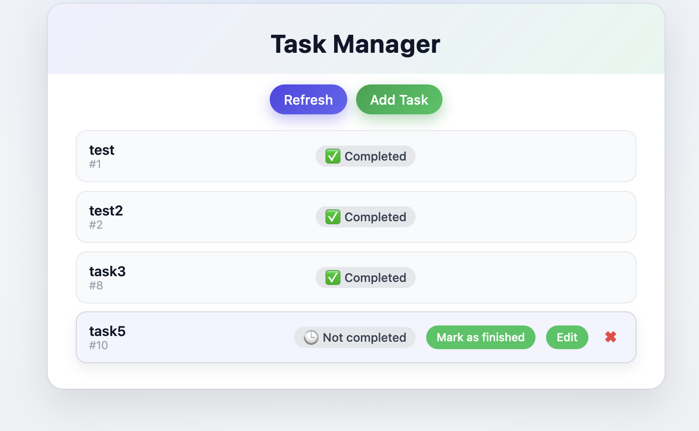
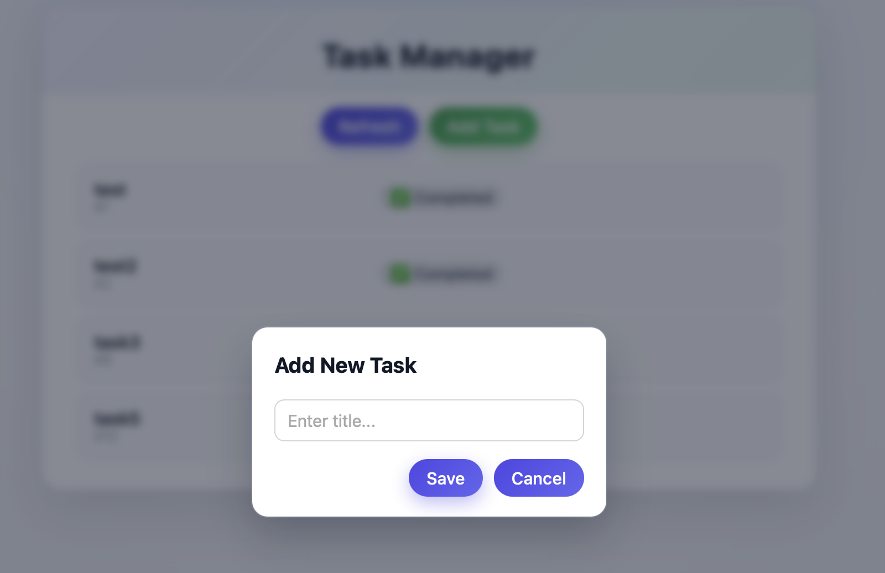
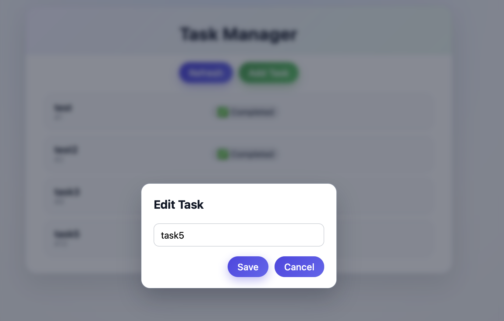

# Task Manager — React + Spring Boot + MySQL

A full-stack task management application built with **React (Vite)** and **Spring Boot**.  
Users can create tasks, edit titles, mark tasks as finished, and delete them through a clean and modern UI.

---

## 🚀 Features

### ✅ Frontend (React)
- Modern and responsive UI  
- Modal windows for adding and editing tasks  
- Smooth animations and hover effects  
- Axios-based communication with REST API  
- Simple component architecture (Vite + React)

### ✅ Backend (Spring Boot)
- REST API with clean controller/service structure  
- Endpoints for full CRUD support  
- MySQL database persistence  
- Cross-Origin support for React dev server  
- Lightweight, production-friendly structure

---

## 🛠️ Tech Stack

**Frontend:**  
- React  
- Vite  
- JavaScript  
- Axios  
- CSS  

**Backend:**  
- Spring Boot  
- Spring Web  
- Spring Data JPA  
- MySQL  

## 📸 Screenshots

### Main UI

### Add Task Modal

### Edit Task Modal

